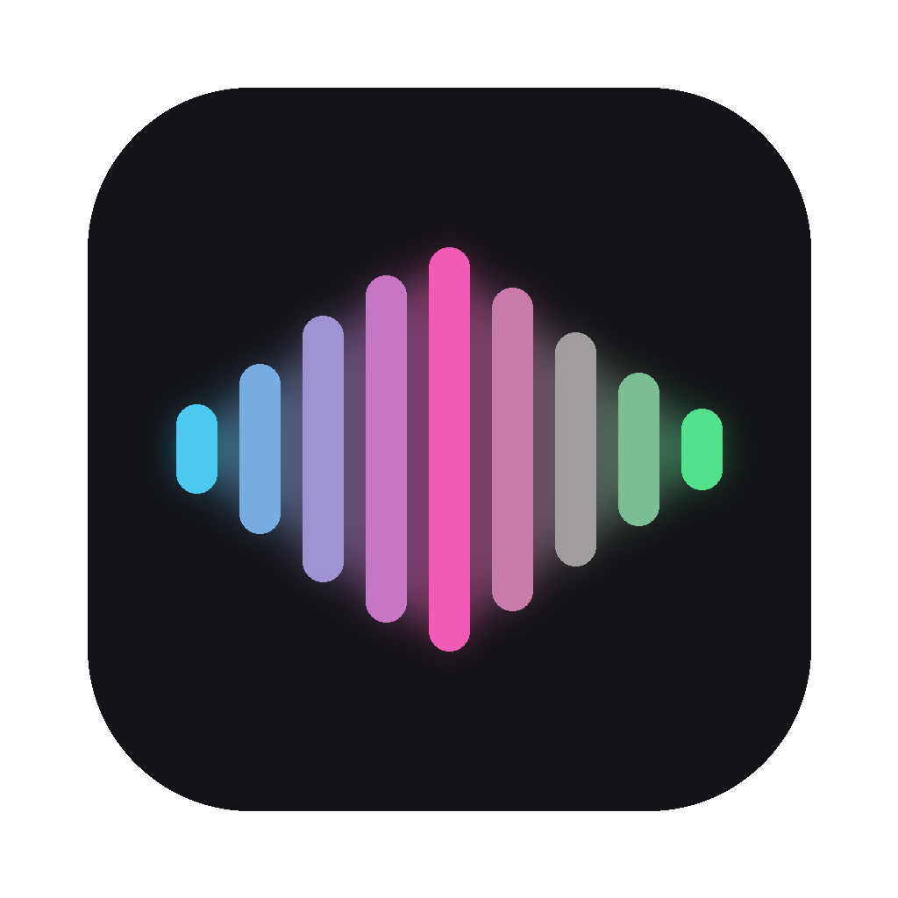

<p align="center">
  
</p>

<h1 align="center">MiniFlow</h1>
<p align="center"><b>Hold a key, talk, and your words appear in any app.</b><br>
A free, open-source voice dictation app for macOS, inspired by Wispr Flow.</p>

---

## What it does

| Mode | How | What happens |
|---|---|---|
| **Dictate** | Hold **Fn** or **Right ⌥**, talk, let go | Your words are cleaned up (no "umm"s, proper punctuation) and pasted at your cursor, in any app |
| **Edit** | Select text, hold **Right ⌘**, say what to change | "Make this shorter", "more formal", "translate to Hindi": the selection is rewritten in place |
| **Prompt** | Dictate inside ChatGPT, Claude, Cursor… | Rambling speech becomes a clear, well-structured AI prompt, following Anthropic's prompting best practices |

**Also:** a live waveform pill that shows your words as you speak · voice commands ("new line", "bullet point", "scratch that", "send it") · searchable history · light and dark themes · errors explained in plain English with a retry button.

## Speed

Text appears **under 1 second** after you stop talking: about 0.3 s to transcribe and 0.5 s for AI cleanup. The live preview runs fully on-device.

## How it works

```
hold key ─▶ record mic ─▶ Whisper (Groq) ─▶ voice commands ─▶ LLM cleanup / prompt / edit ─▶ paste at cursor
              │
              └─▶ tiny Whisper on-device ─▶ live words in the floating pill
```

- **Speech to text:** `whisper-large-v3-turbo` on Groq (or fully offline with `faster-whisper`)
- **Cleanup, Edit and Prompt mode:** a Groq-hosted LLM, picked automatically from the models your key can use
- **Interface:** native macOS (AppKit via PyObjC): a menu bar popover, a floating pill that never steals focus, and a menu bar icon that changes with each state
- **Hotkeys:** `pynput`, plus a Quartz event tap for the Fn / 🌐 key

## Install

Requires macOS 11+ and Python 3.10+.

```bash
git clone https://github.com/Sarthak2805gupta/miniflow.git
cd miniflow
./setup.sh                 # creates .venv and installs everything
cp .env.example .env       # then paste a free key from https://console.groq.com/keys
bash make_app.sh           # builds MiniFlow.app, adds it to Login Items, opens it
```

The first time it opens, macOS asks for **Microphone**, **Accessibility** and **Input Monitoring** access. The panel shows a button that takes you to each one.

Prefer not to build the app? Run `./run.sh` to start it from Terminal.

## Privacy

- Audio is sent to **Groq** for transcription only while you hold the key. With `ENGINE=local` it never leaves your Mac (but cleanup, Edit and Prompt mode need Groq).
- Your API key lives in `.env` and your history in `history.json`. Both stay on your Mac and are git-ignored.

## Settings

Everything is in the menu bar panel → **Settings**: keys, language (Auto-detect handles Hinglish), AI cleanup, Prompt mode apps, pill position, theme, start at login, API key.

## License

MIT
